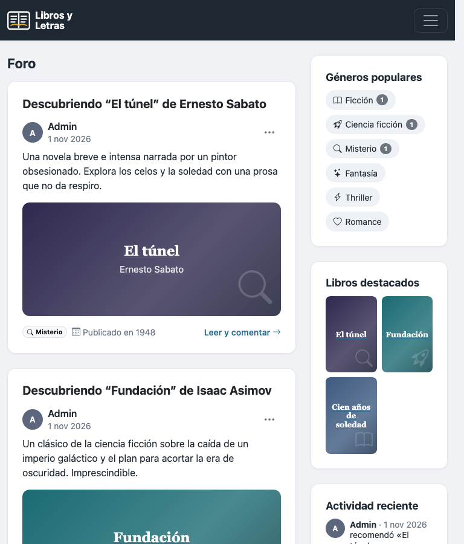
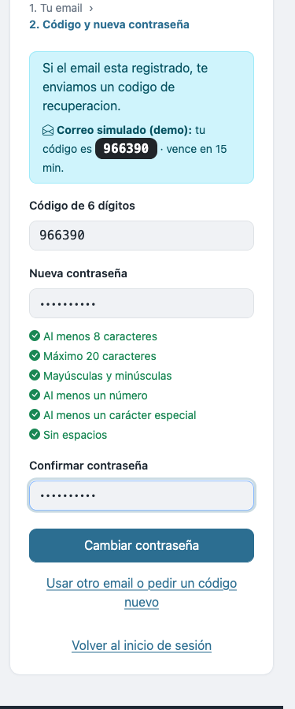
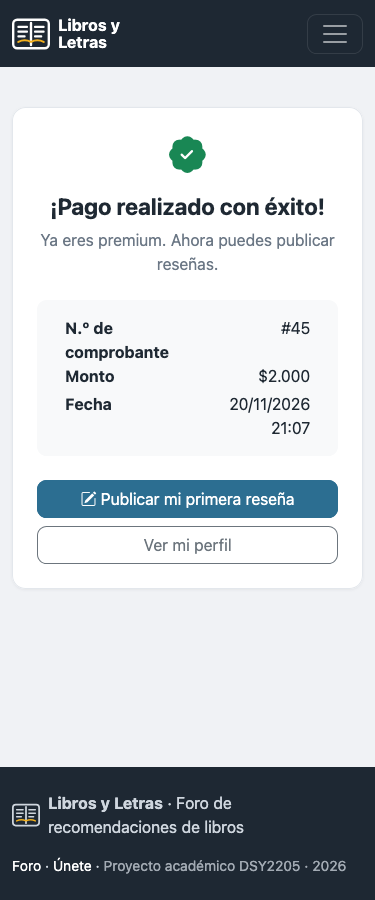
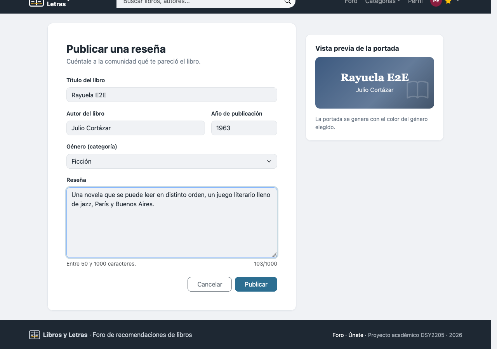
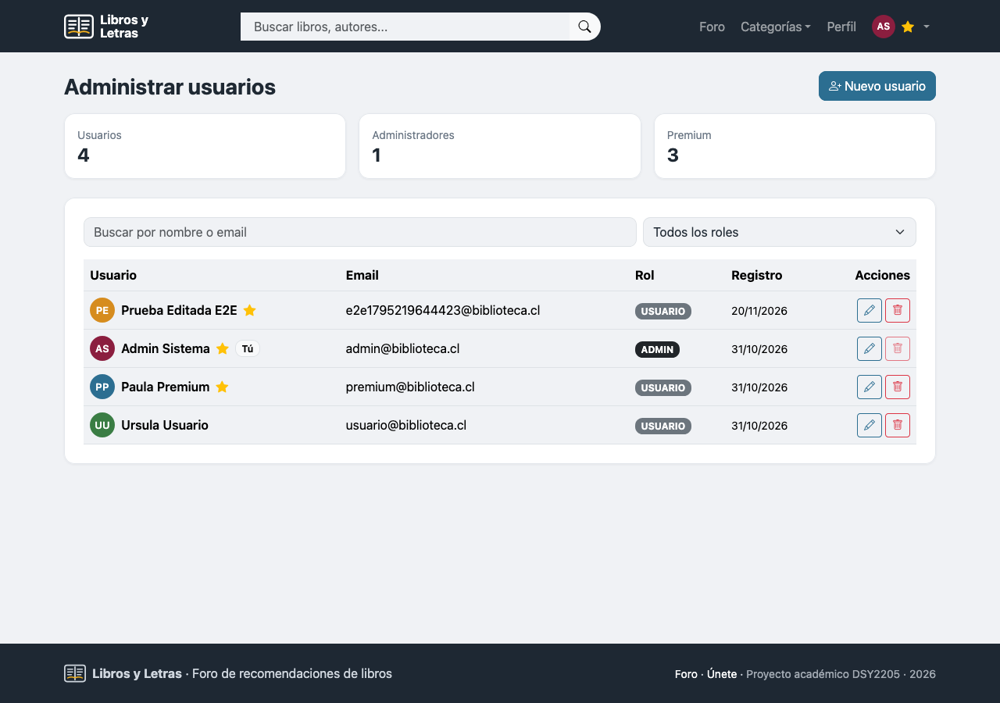

# Libros y Letras · Front (Angular 21)

Frontend del **Sistema de Foros en Línea** con temática de **recomendaciones de libros**. Los usuarios buscan y leen reseñas, comentan, se hacen premium (pago simulado) para publicar, y un administrador gestiona usuarios y modera el contenido.

> Fork de [`cvalverd/pet-app-angular21`](https://github.com/cvalverd/pet-app-angular21) (ejemplo del profesor).
> Se mantiene su configuración (Angular 21 + SSR, Dockerfile, GitHub Actions, despliegue en EC2 por SSM) y se reemplaza la aplicación de mascotas por el foro.

| Microservicio | Repo | Puerto | Responsabilidad |
|---|---|---|---|
| 1. Control de usuarios e inicio de sesión | [`sebcorva/auth_service`](https://github.com/sebcorva/auth_service) | 8081 | Registro, login (JWT), CRUD de usuarios, roles, recuperar contraseña y pago premium |
| 2. Búsqueda, visualización, publicación y comentarios | [`sebcorva/gestor-biblioteca`](https://github.com/sebcorva/gestor-biblioteca) | 8080 | Reseñas por género, búsqueda y comentarios |
| Front (este repo) | `sebcorva/gestor-libros-front-aws` | 4000 | Interfaz Angular |


## Cómo se cumplen los requisitos

### Front

| Req. | Enunciado | Cómo se cumple |
|---|---|---|
| a | Responsive en ≥3 tamaños con grid de 12 columnas | Grid de Bootstrap con 3 breakpoints: **móvil** `col-12` (1 columna), **tablet** `col-md-8` + `col-md-4` (2 columnas) y **escritorio** `col-lg-1` + `col-lg-7` + `col-md-4` (3 columnas, como el mockup). La navbar colapsa en móvil y la tabla de usuarios pasa a tarjetas. Ver [capturas](#capturas) |
| b | HTML, CSS, Bootstrap y JS con Angular | **Bootstrap 5.3** (CSS + `bootstrap.bundle` JS para dropdowns y alertas) y Bootstrap Icons, más el tema propio en `src/styles.css` |
| c | Trabajo con Git | Un issue por funcionalidad, una rama por issue (`feat/<n>-<tema>`) y commits convencionales |
| d | Todas las pantallas y formularios con validaciones | 13 pantallas (ver [tabla](#pantallas)). Reactive Forms con mensajes por campo, más los errores `400` del backend asociados a cada campo |
| e | Información en listas, arreglos o colecciones | `signal<Publicacion[]>`, `signal<Comentario[]>`, `signal<Usuario[]>`, el arreglo `GENEROS` y `computed()` para filtrar por género, buscar y contar (géneros populares, resumen de usuarios) |
| f | Patrón de diseño | MVC + Observer + Singleton + Chain of Responsibility + Guards (ver [Patrón de diseño](#patrón-de-diseño)) |

### Caso

| Requisito | Cómo se cumple |
|---|---|
| ≥5 categorías | Los **14 géneros** del foro (Ficción, Fantasía, Ciencia ficción, Misterio, Thriller, Romance, Histórico, Biografía, Autoayuda, Tecnología, Educación, Filosofía, Poesía, Terror) |
| ≥2 roles | `ADMIN` y `USUARIO` (más el atributo `premium`) con privilegios distintos ([tabla](#roles-y-privilegios)) |
| Inicio de sesión, registro, recuperar contraseña y modificar perfil | `/login`, `/registro`, `/recuperar` y `/perfil` |
| ≥4 validaciones de contraseña | **6 reglas**, en el front (checklist en vivo) y en el backend |
| Formularios validados | Todos los formularios (ver [Validaciones](#validaciones)) |
| Pago simulado | `/premium`: confirma el pago sin pedir datos de tarjeta y muestra el comprobante |
| Diseño propio | Nombre *Libros y Letras*, logo SVG propio, paleta y portadas generadas por género |

## Arquitectura

```
                         EC2 · Nginx :80
Navegador ──HTTP──► ┬─ /auth, /usuarios, /pagos      ──► auth-users        127.0.0.1:8081 ─┐
                    ├─ /publicaciones, /comentarios  ──► gestor-biblioteca 127.0.0.1:8080 ─┼─► Oracle ADB
                    └─ /  (todo lo demás)            ──► este front        127.0.0.1:4000  │
                                                                                            ┘
```

- El navegador solo habla con Nginx (mismo origen), así que **no hace falta CORS**. En local, `proxy.conf.json` hace el mismo enrutamiento.
- Los servicios usan URLs **relativas** (`/auth`, `/publicaciones`…). Las pantallas de reseñas usan `/resenas/...` para no chocar con la ruta `/publicaciones` de la API: si chocaran, recargar la página mostraría el JSON en vez de la app.
- El token JWT lo emite auth-users. El front lo guarda en `localStorage` y el interceptor lo envía en cada request. gestor-biblioteca lo valida con el mismo secreto.
- **SSR:** se mantiene el servidor de Angular del profesor (`src/server.ts`, puerto 4000) con `RenderMode.Client`, de modo que la app se renderiza en el navegador.

## Patrón de diseño

**MVC** adaptado a Angular, igual que en el ejemplo del profesor:

| Capa | Dónde |
|---|---|
| **Modelo** | `models/*` (interfaces iguales a los DTO de los microservicios) y `services/*` (obtienen y persisten datos con `HttpClient`) |
| **Vista** | `pages/*`, `layout/*` y `shared/*` (plantilla + clase) |
| **Controlador** | `app.routes.ts`: qué vista se muestra según la URL, protegida por guards |

| Patrón de apoyo | Dónde |
|---|---|
| **Observer** | Los servicios devuelven `Observable`; los componentes se suscriben. La sesión (`AuthService`) se expone como `signal`, y la navbar, los guards y las vistas reaccionan solas al login, al logout o al pago premium |
| **Singleton** | Servicios con `providedIn: 'root'` (una instancia para toda la app) |
| **Chain of Responsibility** | `core/auth.interceptor.ts`: agrega `Authorization: Bearer` y, ante un `401`, cierra la sesión y redirige al login |
| **Guard** | `core/guards.ts`: `authGuard`, `adminGuard`, `publicarGuard` (premium o ADMIN) e `invitadoGuard` |

## Pantallas

| Ruta | Pantalla | Acceso |
|---|---|---|
| `/` | Foro: feed de reseñas, búsqueda (`?q=`) y sidebar (géneros populares, libros destacados, actividad reciente) | Público |
| `/categoria/:genero` | Reseñas de un género, con filtro por texto | Público |
| `/resenas/:id` | Detalle de la reseña con comentarios | Público (comentar requiere sesión) |
| `/resenas/nueva` | Publicar una reseña | Premium o ADMIN |
| `/resenas/:id/editar` | Editar una reseña | Solo el autor |
| `/login` | Inicio de sesión | Visitante |
| `/registro` | Registro de usuario | Visitante |
| `/recuperar` | Recuperar contraseña (2 pasos, código simulado) | Visitante |
| `/perfil` | Modificar perfil, cambiar contraseña e historial de pagos | Con sesión |
| `/premium` | Hazte premium y pago exitoso | Con sesión |
| `/admin/usuarios` | Lista de usuarios con búsqueda y filtro por rol | ADMIN |
| `/admin/usuarios/nuevo` y `/admin/usuarios/:id/editar` | Crear o editar un usuario (incluye el rol) | ADMIN |

### Roles y privilegios

| Acción | Visitante | USUARIO | USUARIO premium | ADMIN |
|---|:-:|:-:|:-:|:-:|
| Buscar y ver reseñas y comentarios | ✅ | ✅ | ✅ | ✅ |
| Comentar | ❌ | ✅ | ✅ | ✅ |
| Publicar | ❌ | ❌ (va a premium) | ✅ | ✅ |
| Editar una reseña | ❌ | la propia | la propia | la propia |
| Eliminar una reseña o un comentario | ❌ | lo propio | lo propio | ✅ cualquiera (moderación) |
| Administrar usuarios | ❌ | ❌ | ❌ | ✅ |

## Validaciones

**Contraseña (6 reglas, las mismas que en auth-users):**

1. Mínimo 8 caracteres.
2. Máximo 20 caracteres.
3. Mayúsculas y minúsculas.
4. Al menos un número.
5. Al menos un carácter especial.
6. Sin espacios.

Además, la confirmación debe coincidir. Bajo el campo se muestra un **checklist en vivo** en el que cada regla se pone verde al cumplirse.

| Formulario | Validaciones |
|---|---|
| Login | Email obligatorio y con formato válido; contraseña obligatoria |
| Registro / perfil / admin | Nombre y apellido obligatorios (máx. 100, sin solo espacios); email válido (máx. 150); contraseña con las 6 reglas; aceptar normas (registro) |
| Recuperar | Email válido; código de exactamente 6 dígitos; nueva contraseña con las 6 reglas |
| Reseña | Título y autor obligatorios (máx. 100); año de 1 a 4 dígitos y no futuro; género de la lista; reseña de 50 a 1000 caracteres con contador |
| Comentario | Obligatorio, máx. 500 caracteres con contador |

## Estructura

```
src/app/
├── models/      usuario, publicacion, comentario, pago, genero (GENEROS), error-response
├── services/    auth, usuario, pago, publicacion, comentario      (MVC - Modelo)
├── core/        auth.interceptor, guards, password.validators, mensaje-error
├── layout/      navbar, footer
├── shared/      logo, avatar, portada, confirmacion, error-campo, password-checklist, tiempoRelativo
├── pages/
│   ├── auth/    login, registro, recuperar
│   ├── perfil/  perfil, premium
│   ├── foro/    inicio, categoria, publicacion-detalle, publicacion-form, componentes/
│   └── admin/   usuarios-lista, usuario-form
├── testing/     datos y helpers de los tests
└── app.routes.ts                                                 (MVC - Controlador)
```

## Ejecutar en local

Requiere **Node 20.19+, 22.12+ o 24+**, y los dos microservicios corriendo (ver sus README).

```bash
# 1. Backends (cada uno con su .env y su carpeta wallet/)
cd auth_service && ./mvnw spring-boot:run          # :8081
cd gestor-biblioteca && ./mvnw spring-boot:run     # :8080

# 2. Front
npm install
npm start                                          # http://localhost:4200
```

`npm start` usa `proxy.conf.json` para enviar `/auth`, `/usuarios` y `/pagos` a `:8081`, y `/publicaciones` y `/comentarios` a `:8080`.

**Usuarios de prueba:**

| Email | Contraseña | Rol |
|---|---|---|
| `admin@biblioteca.cl` | `Admin2026!` | ADMIN |
| `premium@biblioteca.cl` | `Premium2026!` | USUARIO premium |
| `usuario@biblioteca.cl` | `Usuario2026!` | USUARIO |

## Tests

```bash
npx ng test --watch=false
```

67 tests con Vitest cubren:

- **Validadores:** las 6 reglas de contraseña y la confirmación.
- **Sesión:** `AuthService`, incluida la expiración del token.
- **Interceptor:** el header `Bearer` y el manejo del `401`.
- **Pantallas:** todas, con sus flujos principales y las restricciones por rol.

Las peticiones HTTP se simulan, así que los tests no necesitan los backends.

## Docker

```bash
docker build -t libros-front .
docker run -p 4000:4000 libros-front     # http://localhost:4000
```

La imagen compila la app y la sirve con el servidor de Angular en el puerto 4000. Detrás de Nginx, las rutas de la API se envían a cada microservicio.

## Despliegue en AWS

Un push a `main` ejecuta `.github/workflows/publish-ecr.yml`, que:

1. Construye la imagen.
2. La publica en ECR como `gestor-libros-front:<sha>`.
3. La despliega en la EC2 por SSM, con rollback si falla.
4. Comprueba `/` y `/publicaciones`.

La guía paso a paso (stack de CloudFormation, secretos, wallet, variables de Actions y orden de despliegue) está en **[DESPLIEGUE.md](DESPLIEGUE.md)**.

## Capturas

| Móvil (375 px) | Tablet (768 px) |
|---|---|
|  |  |
|  |  |
|  | |

| Escritorio (1280 px) |
|---|
|  |
|  |
